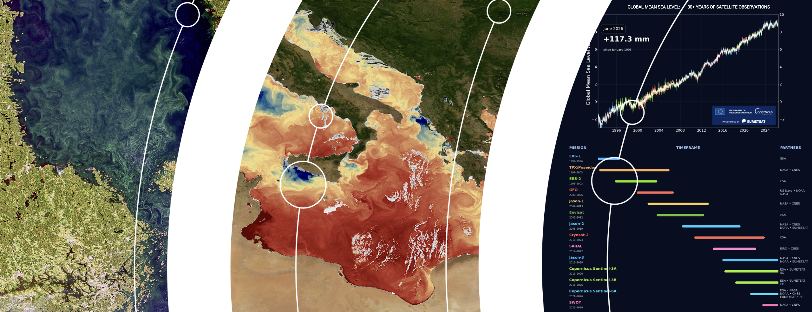

  

# Hi, I'm Ben 👋

I'm a marine Earth observation scientist and **Lead Marine Applications Expert at EUMETSAT**.

My work focuses on satellite remote sensing of the ocean, particularly ocean colour, sea surface temperature and altimetry, and on making Earth observation data more accessible and useful for scientific and operational applications.

### Interests & tools

- 🌊 Marine remote sensing and satellite applications
- 🛰️ Sentinel, Meteosat and other Earth observation missions
- 🐍 Python, xarray, Dask and Jupyter
- ☁️ Cloud-native data: Zarr, COG, Kerchunk and S3
- 🗺️ Geospatial data processing and visualisation
- 🔬 Open science, reproducible workflows and data interoperability

Here you'll find a mixture of scientific Python projects, data processing workflows, experiments and training resources.

*Based in Germany. Interested in oceans, satellites and good code.*
